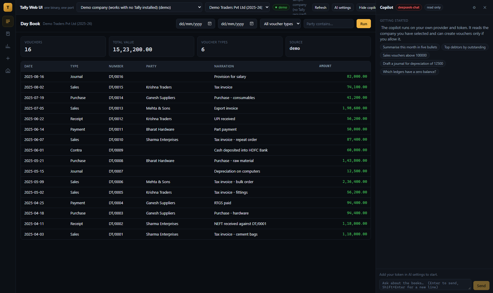

# Tally Web UI

A modern, keyboard-friendly web workspace for **TallyPrime and Tally ERP 9**, built as
**one Go binary that serves the UI and the API on a single port**, with an **AI copilot you
connect using your own token**.

Tally stays the engine of record. This project never re-implements your books.



---

## Run it

```bash
git clone <your-fork> && cd tally
go run .
```

That is the whole setup. Open **http://127.0.0.1:8787**.

No Node, no npm, no second process, no CORS, no proxy. The Vue build is embedded in the
binary; on first run the server writes a working `tally-instances.json` next to itself.

On Windows you can also double-click `run.bat`.

### Flags

| Flag | Default | Meaning |
|---|---|---|
| `--port` | 8787 | HTTP port |
| `--registry` | tally-instances.json | Connection registry |
| `--data` | data | Where AI settings are stored |
| `--allow-writes` | false | Permit the UI and the copilot to write to Tally |

---

## Why it is shaped this way

Tally is not just a database, it is a compliance engine. So this product **does not rewrite
accounting**. It puts a better workspace in front of the engine you already trust:

- **Writes go through Tally's own API**, so GST, statutory validation and the audit trail stay
  correct. Nothing is ever written to `.1800` / `.900` files.
- **Reads pick the best source** for the job — the live XML server when you need Tally's own
  arithmetic, the on-disk files when you need speed or an archive.
- **The copilot uses the same `Engine` interface as the screens.** It can only do what a
  user could do, and only when you allow it.

```
              Vue 3 UI  (embedded in the binary)
                    |
        Go HTTP API + SSE  (one port, one process)
                    |
             engine.Engine   <- one interface, three implementations
       +------------+----------------+-----------------+
       |            |                |
  TallyXMLEngine  FileEngine      DemoEngine
  live Tally      .1800/.900      built-in sample
  (Prime/ERP 9)   via TallyWeb    (no Tally needed)
```

---

## Connections

`tally-instances.json` is the registry. Three kinds exist:

```json
{
  "defaultInstance": "demo",
  "server": { "port": 8787 },
  "instances": [
    { "id": "demo",  "kind": "demo", "label": "Demo company" },

    { "id": "prime", "kind": "tally-xml", "label": "TallyPrime on this machine",
      "product": "tallyprime", "host": "127.0.0.1", "port": 9000,
      "company": "M/S. EXAMPLE AGENCIES (2025-26)", "timeoutSeconds": 30 },

    { "id": "archive", "kind": "tallyweb-file", "label": "ERP 9 archive from disk",
      "product": "erp9", "baseUrl": "http://127.0.0.1:9090",
      "username": "admin", "password": "admin", "companyDir": "100001" }
  ]
}
```

- **`tally-xml`** — a running Tally (Prime **or** ERP 9) on its XML port. Enable it in Tally
  under *F1 → Settings → Connectivity*. Note that Tally's XML server is single-threaded, so the
  engine holds **one serial request queue per instance**: two people never corrupt each other,
  and two instances still run in parallel.
- **`tallyweb-file`** — the Go backend in `TallyWeb-main/backend`, which parses the data
  files directly. It understands **both `.1800` (Prime) and `.900` (ERP 9)**. Read-only here:
  it is for archives, bulk exports and analytical reads.
- **`demo`** — an in-memory sample company, so the product is fully explorable and testable
  with no Tally installed at all.

Switch connections from **Connections** in the rail or the dropdown in the top bar. Each card
shows live reachability.

---

## The AI copilot

Bring your own model. The token is stored on the machine running the server (`data/ai-settings.json`,
mode `0600`) and **is never sent back to the browser** — the settings API returns only a hint.

| Provider kind | Works with |
|---|---|
| `openai` | OpenAI, **DeepSeek**, OpenRouter, Groq, Together, Mistral, vLLM, LM Studio, **Ollama** — anything OpenAI-compatible |
| `anthropic` | Claude, native Messages API with tool use |
| `gemini` | Google Gemini, native function calling |

Presets are one click in **AI settings**. Local runtimes need no token at all.

### What the copilot can actually do

It is not a chat box bolted on. The agent has tools bound to the same engine the screens use:

| Tool | Purpose |
|---|---|
| `describe_context` | Instance, product, health, selected company |
| `list_companies` | Sets of books on the instance |
| `list_ledgers` | Accounts with group and closing balance, searchable |
| `list_vouchers` | Vouchers by type, party and date range |
| `get_report` | Trial balance, P&L, balance sheet, day book, outstanding, ageing, stock summary, GST |
| `create_ledger` | **Write** — only when writes are enabled |
| `create_voucher` | **Write** — only when writes are enabled |

The browser shows each tool call, its arguments and the result as it happens, so you can see the
reasoning rather than trusting a summary.

Writes are gated twice: the server must be started with `--allow-writes`, **and** the switch
*"Allow the assistant to create ledgers and vouchers"* must be on in AI settings. Both default to off.

---

## MCP — the same engine, exposed to any AI client

The MCP server is **in this binary**. No second process, no second port, no glue project.

| Transport | How |
|---|---|
| **Streamable HTTP** | `POST http://127.0.0.1:8787/mcp` — starts with the web server, always on |
| **stdio** | `go run . --mcp-stdio` — for desktop clients that launch a server |

The HTTP transport is stateless: every POST carries a complete JSON-RPC message. It answers with JSON, or with
an SSE `event: message` frame when the client sends `Accept: text/event-stream`. `GET /api/mcp/info` lists the
endpoint and every registered tool.

### 36 tools, built on the same engine the UI uses

| Group | Tools |
|---|---|
| Connections | `tally_list_instances`, `tally_describe`, `tally_list_companies` |
| Masters | `tally_list_ledgers`, `tally_create_ledger` |
| Vouchers | `tally_list_vouchers`, `tally_create_voucher` |
| Reports | `tally_get_report`, plus `tally_trial_balance`, `tally_profit_and_loss`, `tally_balance_sheet`, `tally_day_book`, `tally_outstanding`, `tally_payables`, `tally_ageing`, `tally_stock_summary`, `tally_ledger_balances`, `tally_gst_returns`, `tally_statistics`, `tally_cash_bank_book` |
| Daily documents | `tally_create_sales_invoice`, `tally_create_purchase_invoice`, `tally_create_credit_note`, `tally_create_debit_note`, `tally_create_payment`, `tally_create_receipt`, `tally_create_journal`, `tally_create_contra` |
| Inventory | `tally_list_stock_items`, `tally_create_stock_item` |
| Tally integration | `tally_query_collection` (inline TDL), `tally_evaluate_function`, `tally_export_object`, `tally_execute_action`, `tally_send_raw_xml`, `tally_import_data` |

Writes (`create_*`, `execute_action`, `send_raw_xml`, `import_data`) require `--allow-writes`, and say so
plainly when it is off: *"writes are disabled on this server; restart it with --allow-writes"*.

### Adding it to a client

```json
{
  "mcpServers": {
    "tally": {
      "command": "D:/github/tally/tally-web-ui.exe",
      "args": ["--mcp-stdio"]
    }
  }
}
```

Or point an HTTP client at `http://127.0.0.1:8787/mcp`.

---
## HTTP API

The UI has no private endpoints. Everything is scriptable.

| Method | Path | Purpose |
|---|---|---|
| GET | `/api/health` | Service and configuration state |
| GET | `/api/instances` | Registry with live health per instance |
| POST | `/api/instances/default` | Choose the default instance |
| GET | `/api/companies` | Companies on an instance |
| GET | `/api/ledgers` | Ledgers with balances |
| GET | `/api/stock-items` | Inventory masters with unit, quantity, rate, value |
| POST | `/api/stock-items` | Create an inventory master (writes gated) |
| GET | `/api/vouchers` | Vouchers, filterable |
| GET | `/api/reports` | Named reports |
| POST | `/api/vouchers` | Create a voucher, with `items` for inventory lines (writes gated) |
| POST | `/api/ledgers` | Create a ledger (writes gated) |
| POST | `/api/raw-xml` | Raw Tally XML passthrough (writes gated) |
| GET | `/api/ai/presets` | Provider presets |
| GET/PUT | `/api/ai/settings` | Read masked settings / save token |
| GET | `/api/ai/tools` | The copilot's tool catalogue |
| POST | `/api/ai/chat` | Server-sent events: assistant and tool steps |
| POST | `/mcp` | **MCP** JSON-RPC over Streamable HTTP (SSE when requested) |
| GET | `/api/mcp/info` | MCP endpoint, protocol version and the tool catalogue |

Every data endpoint accepts `?instance=` and `?company=`.

---

## Rebuilding the UI

Only needed if you change anything under `frontend/`. The compiled assets live in
`internal/web/dist` and are committed, which is what makes `go run .` work on a fresh clone.

```bash
npm --prefix frontend install
npm --prefix frontend run build
# copy frontend/dist into internal/web/dist, then:
go build -o tally-web-ui.exe .
```

Or just run `build-ui.bat` on Windows, or `make ui`.

For front-end development with hot reload, run the Go server and `npm --prefix frontend run dev`;
Vite proxies `/api` to port 8787.

---

## Verified

- `go build ./...` and `go vet ./...` clean; a single 10 MB binary with the UI embedded.
- `vite build` and `vue-tsc --noEmit` clean.
- The running binary served the SPA, health, instances (with a real reachability probe that
  correctly reported an unreachable Tally), companies, ledgers, vouchers, trial balance, AI
  presets and masked AI settings.
- `POST /api/ai/chat` without a token returns a clear 400 rather than failing silently.
- SPA deep links fall back to `index.html` correctly.
- **MCP over HTTP**: `initialize`, `tools/list` (26 tools), `tools/call` for `tally_describe` and a filtered
  `tally_list_ledgers`, a blocked write returning `isError`, and an SSE response when `Accept: text/event-stream`.
- **MCP over stdio**: two requests in, two responses out, notification correctly silent — stdout carried the
  protocol and nothing else.
- The screenshot above is the real UI rendered by headless Edge against the real binary, with
  data coming from the engine — not a mockup.

---

## What you can do in the web today

Billing (tax invoice with inventory, purchase, credit and debit notes), receipts, payments,
contra, journals, ledger and stock-item masters, and twelve reports — all posted through
Tally's own API so Tally validates them and the audit trail stays intact.

The full inventory of daily operations, masters and reports, marked built / passthrough /
blocked, is in [docs/TALLY-WEB-COVERAGE.md](docs/TALLY-WEB-COVERAGE.md).

---

## Known limits

1. **The file engine cannot write.** TallyWeb's own documentation says voucher writing is not
   implemented, so `create_ledger`/`create_voucher` return a clear explanation instead of
   risking a corrupt company.
2. **The file engine cannot decode opening balances**, so balance-derived reports from
   `tallyweb-file` can differ from Tally. Read those from a live instance.
3. **Named Tally reports are flattened heuristically.** Tally's display reports are built for
   rendering, not for data exchange, so the raw XML envelope is always returned alongside the
   parsed rows and is the source of truth.
4. **Streaming is at step granularity.** You see tool calls and results as they happen; token-level
   streaming of the final answer is not implemented yet.
5. **Tally may hold uncommitted work in `TUPDATE.TSF`**, so file reads taken while Tally is
   running can miss the newest vouchers.
6. **No authentication yet.** The server binds `127.0.0.1` only. Add auth and TLS before
   exposing it to a network — and never expose Tally's own XML port, which has no auth at all.

---

## Layout

```
tally/                       <- the whole product, one repository, one module
  main.go                    entry point, first-run registry, banner
  go.mod                     module tallywebui (standard library only)
  tally-instances.json       connection registry
  run.bat  build-ui.bat  Makefile
  internal/
    config/                  flags and environment
    engine/                  Engine interface and three implementations
      engine.go                the contract
      tallyxml.go              live Tally (UTF-16LE, serial queue, TDL)
      fileengine.go            TallyWeb backend (.1800 and .900)
      demo.go                  offline sample company
      registry.go              tally-instances.json
      xmltree.go               dependency-free XML walker
    ai/                      provider-agnostic assistant
      provider.go              settings, presets, factory
      openai.go anthropic.go gemini.go
      tools.go                 tools bound to the engine
      agent.go                 the tool-calling loop
    server/                  HTTP API, SSE, embedded UI
    mcp/                     the Model Context Protocol server
      jsonrpc.go               JSON-RPC types and the protocol version
      server.go                dispatch: initialize, tools/list, tools/call
      tally.go                 connections, masters, vouchers, reports, Tally integration
      operations.go            the daily documents and inventory masters
      transport.go             Streamable HTTP and stdio transports
    web/dist/                built Vue app (embedded in the binary)
  frontend/                  Vue 3 + Vite source
    src/{App.vue,api.ts,store.ts,style.css}
    src/components/          SideRail, TopBar, DataTable, AiDock, AiSettingsModal
    src/views/               Invoice, DayBook, Ledgers, Stock, Reports, Compose, Companies
  docs/                      strategy, analysis and design documents
  reference/                 the original projects, kept as source material
    TallyWeb-main.zip          offline binary data engine (Go)
    tally-mcp-main.zip         209-tool MCP server (TypeScript)
    tally-unified.zip          earlier prototype of this app
```

The two original repositories are archived rather than deleted: their ideas now live in
`internal/engine/`, but the originals remain the reference for Tally's binary format and for the
full 209-tool surface. `node_modules` and stray build artefacts were stripped from the archives.
See `docs/` for the strategy and analysis documents.